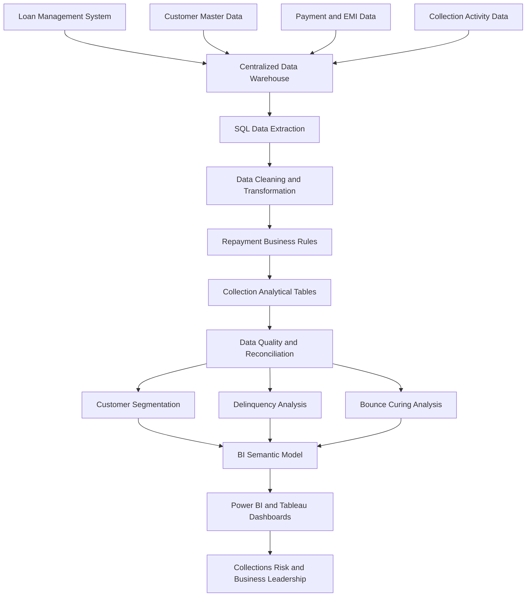
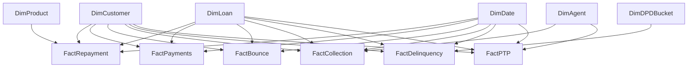
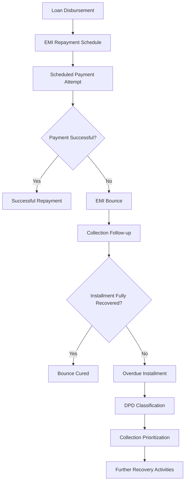

# Collections & Repayment Analytics

### End-to-End Digital Lending & Collection Optimization Solution


---

## Project Overview

This project demonstrates an end-to-end analytics solution
designed to monitor loan repayment behavior, EMI bounce
rates, delinquency, bounce curing and collection performance
within a digital lending environment.

The solution integrates customer information, loan details,
repayment schedules, payment transactions, collection
activities and delinquency information into a centralized
analytical framework.

SQL-based data processing, customer segmentation,
cohort analysis and interactive BI dashboards enable
business stakeholders to identify repayment risks,
prioritize collection activities and monitor recovery
performance.

---

## Business Impact

The solution is designed to support:

- Improved visibility into EMI repayment performance.
- Identification of high-bounce customer segments.
- Improved monitoring of bounce curing performance.
- Data-driven collection prioritization.
- Early identification of delinquent accounts.
- Improved visibility into collection agent performance.
- Identification of recurring repayment issues.
- Standardized collection KPI definitions.
- Reduced dependency on manual reporting.
- Improved collaboration between collections and risk teams.
- Better monitoring of outstanding loan balances.
- Improved operational decision-making.

---

## Problem Statement

Digital lending organizations manage large volumes
of loan accounts, scheduled installments, payment
transactions and collection activities.

Without a centralized analytical solution, it becomes
difficult to identify repayment risks, understand
EMI bounce behavior and measure collection effectiveness.

Key challenges include:

- High EMI bounce rates.
- Delayed customer repayments.
- Limited visibility into bounce curing performance.
- Difficulty identifying high-risk customer segments.
- Increasing overdue loan balances.
- Inconsistent collection KPI calculations.
- Manual preparation of collection reports.
- Limited visibility into agent productivity.
- Difficulty tracking customer repayment history.
- Delayed identification of worsening delinquency.
- Inefficient prioritization of collection activities.

---

## Business Objectives

- Develop a centralized collection analytics framework.
- Monitor scheduled EMI repayment performance.
- Identify customers with recurring EMI bounces.
- Analyze bounce reasons and repayment behavior.
- Measure bounce curing and recovery performance.
- Monitor Days Past Due (DPD).
- Track delinquency movement across DPD buckets.
- Segment customers based on repayment behavior.
- Analyze collection agent performance.
- Monitor Promise to Pay commitments.
- Automate recurring analytical reports.
- Support data-driven collection strategies.

---

## Data Overview

### Data Sources

- Loan management systems
- Customer master data
- Loan application information
- Loan disbursement records
- EMI repayment schedules
- Payment transaction records
- EMI presentation and bounce records
- Collection activity records
- Collection agent information
- Promise to Pay records
- Customer risk classifications
- Historical delinquency snapshots

### Data Granularity

- Customer-level records
- Loan account-level records
- Installment-level repayment records
- Payment transaction-level records
- Collection activity-level records
- Daily and monthly delinquency snapshots
- Agent-level collection performance

### Important Data Fields

| Field | Description |
|---|---|
| CustomerID | Unique customer identifier |
| LoanID | Unique loan account identifier |
| InstallmentID | Unique scheduled installment |
| LoanAmount | Original loan amount |
| DisbursementDate | Loan disbursement date |
| EMIAmount | Scheduled installment amount |
| DueDate | Scheduled repayment date |
| PaymentDate | Actual payment date |
| PaymentAmount | Amount received from customer |
| BounceFlag | Indicates a bounced payment attempt |
| BounceReason | Reason for unsuccessful payment |
| FirstBounceDate | Date of first eligible EMI bounce |
| CureDate | Date bounced installment was fully recovered |
| OutstandingPrincipal | Remaining loan principal |
| OverdueAmount | Outstanding overdue installment amount |
| DPD | Days Past Due |
| CreditScore | Customer credit score |
| RiskCategory | Customer risk classification |
| AgentID | Collection agent identifier |
| ContactDate | Collection contact date |
| ContactStatus | Outcome of collection activity |
| PTPDate | Promised repayment date |
| PTPAmount | Promised repayment amount |
| SnapshotDate | Reporting snapshot date |

---

## Solution Architecture



---

## Technology Stack

| Technology | Purpose |
|---|---|
| SQL | Data extraction, transformation and analysis |
| SQL Server | Representative relational database |
| Power BI | Interactive collection dashboards |
| Tableau | Data visualization and analytical reporting |
| DAX | Collection KPI calculations |
| Python | Exploratory analysis and automation |
| Pandas | Data cleaning and customer segmentation |
| Excel | Data validation and ad hoc analysis |
| GitHub | Version control and documentation |

---

## Data Model

The analytical solution follows dimensional modeling
principles to support scalable lending and collection
reporting.

### Fact Tables

| Table | Description |
|---|---|
| FactLoan | Loan account and disbursement information |
| FactRepayment | Scheduled installment and repayment status |
| FactPayments | Individual payment transactions |
| FactBounce | EMI presentation and bounce events |
| FactCollection | Customer contact and collection activities |
| FactDelinquency | Historical loan-level DPD snapshots |
| FactPTP | Promise to Pay commitments and outcomes |

### Dimension Tables

| Table | Description |
|---|---|
| DimCustomer | Customer demographic and classification data |
| DimLoan | Loan account attributes |
| DimDate | Calendar and reporting periods |
| DimProduct | Loan product classification |
| DimAgent | Collection agent information |
| DimRegion | Geographic classification |
| DimRiskCategory | Customer risk classification |
| DimDPDBucket | Delinquency bucket classification |

### Semantic Model



### Relationship Design

- One-to-many relationships between dimensions and facts.
- Shared customer, loan and date dimensions.
- Clearly defined granularity for every fact table.
- Separate payment and installment-level information.
- Historical delinquency snapshots.
- Single-direction filtering where appropriate.
- Avoidance of unnecessary many-to-many relationships.
- Prevention of duplicate payment amounts during joins.

Loan balances are snapshot-based metrics and should
not be summed across multiple reporting dates.

---

## Loan Repayment Lifecycle



---

## Implementation Approach

### 1. Business Requirement Analysis

- Understand lending and collection processes.
- Identify important repayment KPIs.
- Define EMI bounce and bounce curing rules.
- Understand delinquency classifications.
- Identify collection reporting requirements.
- Collaborate with collections and risk stakeholders.

### 2. Data Extraction

- Extract customer and loan information.
- Retrieve EMI repayment schedules.
- Extract payment transaction records.
- Retrieve EMI bounce information.
- Extract collection activity records.
- Retrieve historical delinquency information.
- Integrate collection agent details.

### 3. Data Cleaning and Transformation

- Standardize customer and loan identifiers.
- Remove duplicate records.
- Handle missing values.
- Standardize payment status classifications.
- Validate repayment dates.
- Reconcile payment transactions.
- Apply installment-level payment allocation.
- Calculate overdue balances.
- Develop reusable SQL transformation logic.

### 4. EMI Bounce Analysis

- Identify eligible EMI presentation attempts.
- Calculate first-presentation bounce rates.
- Analyze bounce reasons.
- Identify recurring EMI bounces.
- Analyze bounce rates by customer segment.
- Compare repayment performance across loan products.
- Identify high-bounce cohorts.

### 5. Bounce Curing Analysis

- Identify bounced installments.
- Track subsequent repayment transactions.
- Calculate installment recovery status.
- Calculate days required to cure a bounce.
- Analyze 7-day, 15-day and 30-day cure rates.
- Identify customer segments with low recovery rates.
- Monitor outstanding bounced installments.

### 6. Delinquency Analysis

- Calculate Days Past Due.
- Classify accounts into DPD buckets.
- Analyze overdue loan balances.
- Monitor delinquency trends.
- Track movement between delinquency buckets.
- Identify worsening repayment behavior.

### 7. Customer Segmentation

- Segment customers by repayment history.
- Analyze customers by credit score.
- Identify recurring bounce customers.
- Analyze customer risk categories.
- Segment customers by overdue amount.
- Identify collection prioritization opportunities.

### 8. Collection Performance Analysis

- Monitor collection activity volumes.
- Analyze customer contact outcomes.
- Monitor Promise to Pay commitments.
- Calculate Promise to Pay fulfillment rates.
- Analyze recovery performance.
- Monitor collection agent productivity.

### 9. Dashboard Development

- Develop interactive BI dashboards.
- Create executive collection scorecards.
- Implement customer and loan-level drill-downs.
- Develop repayment and delinquency trend reports.
- Create collection agent performance dashboards.
- Enable dynamic filtering across business dimensions.

### 10. Reporting Automation and Validation

- Automate recurring SQL reporting workflows.
- Standardize collection KPI calculations.
- Validate source-to-target financial totals.
- Monitor data completeness.
- Reduce repetitive manual reporting activities.
- Document business rules and analytical definitions.

---

## Key Performance Indicators

| KPI | Business Definition |
|---|---|
| Total Active Loans | Number of active loan accounts |
| Scheduled EMI Amount | Total installments due during the selected period |
| Presented EMIs | Unique installments with an eligible first payment presentation |
| Bounced EMIs | Presented installments whose first attempt failed |
| EMI Bounce Rate | Bounced EMIs divided by presented EMIs |
| Cured EMIs | Bounced installments subsequently recovered in full |
| Bounce Cure Rate | Cured EMIs divided by eligible bounced EMIs |
| Collection Efficiency | Amount collected against scheduled dues divided by scheduled dues |
| Total Overdue Amount | Unpaid overdue installment amounts |
| DPD | Days since the oldest unpaid installment became due |
| PAR 30+ | Principal balance of loans more than 30 DPD divided by eligible outstanding principal |
| PAR 90+ | Principal balance of loans more than 90 DPD divided by eligible outstanding principal |
| Roll Rate | Proportion of accounts moving between DPD buckets |
| Recovery Rate | Amount recovered from an eligible overdue cohort divided by its opening overdue amount |
| PTP Kept Rate | Fulfilled commitments divided by matured eligible commitments |
| Contact Rate | Successfully contacted assigned accounts divided by eligible assigned accounts |
| Agent Productivity | Collection outcomes relative to agent activity or working time |

All financial KPI definitions should be aligned
with the applicable lending and collection policies.

---

## Delinquency Classification

Days Past Due is used to classify loan accounts
based on the age of their oldest unpaid installment.

| DPD Bucket | Description |
|---|---|
| Current | No overdue installment |
| 1-30 DPD | Early-stage delinquency |
| 31-60 DPD | Moderate delinquency |
| 61-90 DPD | Advanced delinquency |
| 91-120 DPD | High-risk delinquency |
| 121+ DPD | Long-outstanding delinquency |

These classifications are analytical categories
and do not independently establish regulatory
asset classification or default status.

---

## Sample SQL Implementation

The following examples use a representative
SQL Server database and synthetic table names.

### 1. Monthly EMI Bounce Rate

```sql
SELECT
    EOMONTH(DueDate) AS ReportingMonth,

    COUNT(*) AS PresentedEMIs,

    SUM(
        CASE
            WHEN FirstBounceFlag = 1
            THEN 1 ELSE 0
        END
    ) AS BouncedEMIs,

    CAST(
        100.0 *
        SUM(
            CASE
                WHEN FirstBounceFlag = 1
                THEN 1 ELSE 0
            END
        ) / NULLIF(COUNT(*), 0)
        AS DECIMAL(10,2)
    ) AS BounceRate

FROM FactRepayment

WHERE FirstPresentedFlag = 1

GROUP BY EOMONTH(DueDate)

ORDER BY ReportingMonth;
```

The repayment table is assumed to contain one row
per scheduled installment.

Using the first payment presentation prevents
multiple retries from inflating the bounce rate.

---

### 2. Monthly Bounce Curing Analysis

```sql
DECLARE @AsOfDate DATE = '2026-10-31';

SELECT
    EOMONTH(FirstBounceDate) AS BounceMonth,

    COUNT(*) AS BouncedEMIs,

    SUM(
        CASE
            WHEN CureDate >= FirstBounceDate
             AND CureDate <= @AsOfDate
            THEN 1 ELSE 0
        END
    ) AS CuredEMIs,

    CAST(
        100.0 *
        SUM(
            CASE
                WHEN CureDate >= FirstBounceDate
                 AND CureDate <= @AsOfDate
                THEN 1 ELSE 0
            END
        ) / NULLIF(COUNT(*), 0)
        AS DECIMAL(10,2)
    ) AS BounceCureRate

FROM FactRepayment

WHERE FirstBounceFlag = 1
  AND FirstBounceDate <= @AsOfDate

GROUP BY EOMONTH(FirstBounceDate)

ORDER BY BounceMonth;
```

This query measures cumulative bounce recovery
as of the selected reporting date.

Recent cohorts may have less time to cure and
should not be directly compared with mature cohorts.

---

### 3. Seven-Day, Fifteen-Day and Thirty-Day Cure Rates

```sql
DECLARE @AsOfDate DATE = '2026-10-31';

WITH BounceCohort AS
(
    SELECT
        InstallmentID,
        FirstBounceDate,
        CureDate,

        DATEDIFF(
            DAY,
            FirstBounceDate,
            CureDate
        ) AS DaysToCure

    FROM FactRepayment

    WHERE FirstBounceFlag = 1
      AND FirstBounceDate <= @AsOfDate
)
SELECT
    EOMONTH(FirstBounceDate) AS BounceMonth,

    COUNT(*) AS TotalBounces,

    CAST(
        100.0 *
        SUM(
            CASE
                WHEN DATEADD(
                    DAY, 7, FirstBounceDate
                ) <= @AsOfDate
                 AND DaysToCure BETWEEN 0 AND 7
                THEN 1 ELSE 0
            END
        ) /
        NULLIF(
            SUM(
                CASE
                    WHEN DATEADD(
                        DAY, 7, FirstBounceDate
                    ) <= @AsOfDate
                    THEN 1 ELSE 0
                END
            ), 0
        )
        AS DECIMAL(10,2)
    ) AS CureRate7Days,

    CAST(
        100.0 *
        SUM(
            CASE
                WHEN DATEADD(
                    DAY, 15, FirstBounceDate
                ) <= @AsOfDate
                 AND DaysToCure BETWEEN 0 AND 15
                THEN 1 ELSE 0
            END
        ) /
        NULLIF(
            SUM(
                CASE
                    WHEN DATEADD(
                        DAY, 15, FirstBounceDate
                    ) <= @AsOfDate
                    THEN 1 ELSE 0
                END
            ), 0
        )
        AS DECIMAL(10,2)
    ) AS CureRate15Days,

    CAST(
        100.0 *
        SUM(
            CASE
                WHEN DATEADD(
                    DAY, 30, FirstBounceDate
                ) <= @AsOfDate
                 AND DaysToCure BETWEEN 0 AND 30
                THEN 1 ELSE 0
            END
        ) /
        NULLIF(
            SUM(
                CASE
                    WHEN DATEADD(
                        DAY, 30, FirstBounceDate
                    ) <= @AsOfDate
                    THEN 1 ELSE 0
                END
            ), 0
        )
        AS DECIMAL(10,2)
    ) AS CureRate30Days

FROM BounceCohort

GROUP BY EOMONTH(FirstBounceDate)

ORDER BY BounceMonth;
```

Only installments that have completed the relevant
observation window are included in each denominator.

This prevents immature cohorts from producing
misleading recovery comparisons.

---

### 4. Identify Customers with Recurring EMI Bounces

```sql
WITH CustomerBounce AS
(
    SELECT
        CustomerID,

        COUNT(*) AS PresentedEMIs,

        SUM(
            CASE
                WHEN FirstBounceFlag = 1
                THEN 1 ELSE 0
            END
        ) AS BouncedEMIs

    FROM FactRepayment

    WHERE FirstPresentedFlag = 1

    GROUP BY CustomerID
)
SELECT
    CustomerID,
    PresentedEMIs,
    BouncedEMIs,

    CAST(
        100.0 * BouncedEMIs /
        NULLIF(PresentedEMIs, 0)
        AS DECIMAL(10,2)
    ) AS BounceRate,

    CASE
        WHEN BouncedEMIs >= 3
            THEN 'Frequent Bounce'
        WHEN BouncedEMIs = 2
            THEN 'Repeat Bounce'
        WHEN BouncedEMIs = 1
            THEN 'Single Bounce'
        ELSE 'No Bounce'
    END AS RepaymentSegment

FROM CustomerBounce

ORDER BY BouncedEMIs DESC;
```

The segmentation thresholds are illustrative.

A defined historical observation window should
be used for operational customer segmentation.

---

### 5. Days Past Due Calculation

```sql
DECLARE @ReportingDate DATE = '2026-10-31';

WITH OverdueInstallments AS
(
    SELECT
        LoanID,
        MIN(DueDate) AS OldestUnpaidDueDate,
        SUM(OutstandingAmount) AS OverdueAmount

    FROM FactInstallmentSnapshot

    WHERE SnapshotDate = @ReportingDate
      AND DueDate < @ReportingDate
      AND OutstandingAmount > 0

    GROUP BY LoanID
)
SELECT
    L.LoanID,

    COALESCE(O.OverdueAmount, 0)
        AS OverdueAmount,

    COALESCE(
        DATEDIFF(
            DAY,
            O.OldestUnpaidDueDate,
            @ReportingDate
        ), 0
    ) AS DPD

FROM FactLoanSnapshot L

LEFT JOIN OverdueInstallments O
    ON L.LoanID = O.LoanID

WHERE L.SnapshotDate = @ReportingDate;
```

DPD is calculated using the oldest outstanding
overdue installment for each loan account.

Historical calculations require balances that
accurately represent the selected reporting date.

---

### 6. DPD Bucket Classification

```sql
SELECT
    LoanID,
    CustomerID,
    OutstandingPrincipal,
    OverdueAmount,
    DPD,

    CASE
        WHEN DPD IS NULL OR DPD < 0
            THEN 'Unknown'
        WHEN DPD = 0
            THEN 'Current'
        WHEN DPD <= 30
            THEN '1-30 DPD'
        WHEN DPD <= 60
            THEN '31-60 DPD'
        WHEN DPD <= 90
            THEN '61-90 DPD'
        WHEN DPD <= 120
            THEN '91-120 DPD'
        ELSE '121+ DPD'
    END AS DPDBucket

FROM FactDelinquency;
```

---

### 7. Portfolio at Risk Analysis

```sql
DECLARE @ReportingDate DATE = '2026-10-31';

SELECT
    SUM(OutstandingPrincipal)
        AS TotalOutstandingPrincipal,

    SUM(
        CASE
            WHEN DPD > 30
            THEN OutstandingPrincipal
            ELSE 0
        END
    ) AS PAR30Balance,

    SUM(
        CASE
            WHEN DPD > 90
            THEN OutstandingPrincipal
            ELSE 0
        END
    ) AS PAR90Balance,

    CAST(
        100.0 *
        SUM(
            CASE
                WHEN DPD > 30
                THEN OutstandingPrincipal
                ELSE 0
            END
        ) /
        NULLIF(SUM(OutstandingPrincipal), 0)
        AS DECIMAL(10,2)
    ) AS PAR30Percentage,

    CAST(
        100.0 *
        SUM(
            CASE
                WHEN DPD > 90
                THEN OutstandingPrincipal
                ELSE 0
            END
        ) /
        NULLIF(SUM(OutstandingPrincipal), 0)
        AS DECIMAL(10,2)
    ) AS PAR90Percentage

FROM FactDelinquency

WHERE SnapshotDate = @ReportingDate
  AND OutstandingPrincipal > 0
  AND DPD IS NOT NULL;
```

Portfolio at Risk measures the outstanding principal
associated with delinquent loan accounts rather than
only their overdue installment amounts.

---

### 8. Monthly Delinquency Roll Rate

```sql
DECLARE @PreviousMonth DATE = '2026-09-30';
DECLARE @CurrentMonth DATE = '2026-10-31';

WITH PreviousSnapshot AS
(
    SELECT
        LoanID,
        DPDBucket

    FROM FactDelinquency

    WHERE SnapshotDate = @PreviousMonth
),
CurrentSnapshot AS
(
    SELECT
        LoanID,
        DPDBucket

    FROM FactDelinquency

    WHERE SnapshotDate = @CurrentMonth
),
Transitions AS
(
    SELECT
        P.DPDBucket AS PreviousBucket,

        COALESCE(
            C.DPDBucket,
            'Not Observed'
        ) AS CurrentBucket,

        COUNT(*) AS LoanCount

    FROM PreviousSnapshot P

    LEFT JOIN CurrentSnapshot C
        ON P.LoanID = C.LoanID

    GROUP BY
        P.DPDBucket,
        COALESCE(
            C.DPDBucket,
            'Not Observed'
        )
)
SELECT
    PreviousBucket,
    CurrentBucket,
    LoanCount,

    CAST(
        100.0 * LoanCount /
        NULLIF(
            SUM(LoanCount) OVER
            (
                PARTITION BY PreviousBucket
            ), 0
        )
        AS DECIMAL(10,2)
    ) AS RollRate

FROM Transitions

ORDER BY PreviousBucket, CurrentBucket;
```

The calculation assumes one record per loan
and reporting snapshot.

Missing accounts are classified separately
instead of automatically treating them as recovered.

---

### 9. Collection Efficiency

```sql
DECLARE @AsOfDate DATE = '2026-10-31';

SELECT
    EOMONTH(DueDate) AS ReportingMonth,

    SUM(EMIAmount) AS ScheduledAmount,

    SUM(
        CASE
            WHEN COALESCE(AllocatedPaidAmount, 0)
                 > EMIAmount
            THEN EMIAmount
            WHEN COALESCE(AllocatedPaidAmount, 0) < 0
            THEN 0
            ELSE COALESCE(AllocatedPaidAmount, 0)
        END
    ) AS CollectedAgainstDues,

    CAST(
        100.0 *
        SUM(
            CASE
                WHEN COALESCE(AllocatedPaidAmount, 0)
                     > EMIAmount
                THEN EMIAmount
                WHEN COALESCE(AllocatedPaidAmount, 0) < 0
                THEN 0
                ELSE COALESCE(AllocatedPaidAmount, 0)
            END
        ) / NULLIF(SUM(EMIAmount), 0)
        AS DECIMAL(10,2)
    ) AS CollectionEfficiency

FROM FactInstallmentSnapshot

WHERE SnapshotDate = @AsOfDate
  AND DueDate <= @AsOfDate
  AND EMIAmount > 0

GROUP BY EOMONONTH(DueDate);
```

Replace EOMONONTH in the final GROUP BY with
EOMONTH when executing the query.

This example measures cumulative installment
collection efficiency as of a reporting date.

Payments must be allocated to the correct installment,
and advance payments and recoveries should be
reported separately where required.

---

### 10. Promise to Pay Performance

```sql
DECLARE @AsOfDate DATE = '2026-10-31';

SELECT
    AgentID,

    COUNT(*) AS MaturedPromises,

    SUM(
        CASE
            WHEN FulfillmentDate <= PTPDate
             AND FulfilledAmount >= PTPAmount
            THEN 1 ELSE 0
        END
    ) AS KeptPromises,

    CAST(
        100.0 *
        SUM(
            CASE
                WHEN FulfillmentDate <= PTPDate
                 AND FulfilledAmount >= PTPAmount
                THEN 1 ELSE 0
            END
        ) / NULLIF(COUNT(*), 0)
        AS DECIMAL(10,2)
    ) AS PTPKeptRate

FROM FactPTP

WHERE PTPDate <= @AsOfDate
  AND PTPAmount > 0
  AND IsEligible = 1

GROUP BY AgentID

ORDER BY PTPKeptRate DESC;
```

Only matured and eligible commitments are included
to avoid understating performance due to future promises.

---

## Customer Repayment Segmentation

Customer segmentation helps identify differences
in repayment behavior and collection requirements.

| Segment | Representative Criteria |
|---|---|
| Regular Payers | Consistent repayment history |
| Occasional Bounce | Isolated EMI bounce |
| Repeat Bounce | Multiple historical EMI bounces |
| Early Delinquency | 1-30 DPD |
| Moderate Delinquency | 31-60 DPD |
| High Delinquency | Above 60 DPD |
| Recently Cured | Previously bounced installment recovered |

Segmentation should use appropriate observation windows,
validated business rules and responsible lending practices.

---

## Python Exploratory Data Analysis

Python and Pandas can be used to analyze customer
repayment patterns and identify high-bounce segments.

### Data Preparation

```python
import pandas as pd

df = pd.read_csv("datasets/repayment_data.csv")

df["DueDate"] = pd.to_datetime(
    df["DueDate"],
    errors="coerce"
)

df["FirstBounceDate"] = pd.to_datetime(
    df["FirstBounceDate"],
    errors="coerce"
)

df["CureDate"] = pd.to_datetime(
    df["CureDate"],
    errors="coerce"
)

df["EMIAmount"] = pd.to_numeric(
    df["EMIAmount"],
    errors="coerce"
)

df = df.dropna(
    subset=["InstallmentID", "LoanID", "DueDate"]
)

if df["InstallmentID"].duplicated().any():
    raise ValueError(
        "Duplicate installment records detected."
    )

df["ReportingMonth"] = (
    df["DueDate"].dt.to_period("M")
)
```

### Monthly Bounce Rate Analysis

```python
presented = df.loc[
    df["FirstPresentedFlag"] == 1
].copy()

if not presented["FirstBounceFlag"].isin([0, 1]).all():
    raise ValueError("Invalid bounce flags.")

monthly_bounce = (
    presented.groupby("ReportingMonth")
    .agg(
        PresentedEMIs=("InstallmentID", "count"),
        BouncedEMIs=("FirstBounceFlag", "sum")
    )
    .reset_index()
)

monthly_bounce["BounceRate"] = (
    monthly_bounce["BouncedEMIs"]
    / monthly_bounce["PresentedEMIs"]
    * 100
)

print(monthly_bounce)
```

### Customer-Level Segmentation

```python
customer_summary = (
    presented.groupby("CustomerID")
    .agg(
        TotalEMIs=("InstallmentID", "count"),
        TotalBounces=("FirstBounceFlag", "sum")
    )
    .reset_index()
)

customer_summary["BounceRate"] = (
    customer_summary["TotalBounces"]
    / customer_summary["TotalEMIs"]
    * 100
)

def classify_customer(bounces):
    if bounces >= 3:
        return "Frequent Bounce"
    elif bounces == 2:
        return "Repeat Bounce"
    elif bounces == 1:
        return "Single Bounce"
    return "No Bounce"

customer_summary["RepaymentSegment"] = (
    customer_summary["TotalBounces"]
    .apply(classify_customer)
)

print(customer_summary.head())
```

### Bounce Rate Visualization

```python
import matplotlib.pyplot as plt

monthly_bounce["ReportingMonth"] = (
    monthly_bounce["ReportingMonth"].astype(str)
)

plt.figure(figsize=(12, 5))

plt.plot(
    monthly_bounce["ReportingMonth"],
    monthly_bounce["BounceRate"],
    marker="o"
)

plt.title("Monthly EMI Bounce Rate")
plt.xlabel("Reporting Month")
plt.ylabel("Bounce Rate (%)")
plt.xticks(rotation=45)
plt.grid(alpha=0.3)
plt.tight_layout()
plt.show()
```

---

## Sample DAX Measures

### Total Active Loans

```dax
Total Active Loans =
CALCULATE(
    DISTINCTCOUNT(FactLoan[LoanID]),
    FactLoan[LoanStatus] = "Active"
)
```

### Total Scheduled EMI

```dax
Total Scheduled EMI =
SUM(FactRepayment[EMIAmount])
```

### Presented EMIs

```dax
Presented EMIs =
CALCULATE(
    DISTINCTCOUNT(FactRepayment[InstallmentID]),
    FactRepayment[FirstPresentedFlag] = 1
)
```

### Bounced EMIs

```dax
Bounced EMIs =
CALCULATE(
    [Presented EMIs],
    FactRepayment[FirstBounceFlag] = 1
)
```

### EMI Bounce Rate

```dax
EMI Bounce Rate =
DIVIDE(
    [Bounced EMIs],
    [Presented EMIs]
)
```

### Cured EMIs

```dax
Cured EMIs =
VAR AsOfDate =
    MAX(DimDate[Date])
RETURN
    CALCULATE(
        [Bounced EMIs],
        FILTER(
            FactRepayment,
            NOT ISBLANK(FactRepayment[CureDate])
                && FactRepayment[CureDate]
                    >= FactRepayment[FirstBounceDate]
                && FactRepayment[CureDate] <= AsOfDate
        )
    )
```

### Bounce Cure Rate

```dax
Bounce Cure Rate =
DIVIDE(
    [Cured EMIs],
    [Bounced EMIs]
)
```

This measure uses the selected installment cohort
and the end of the selected date context as the
observation date.

A separate as-of date selector can be used for
more flexible historical cohort reporting.

### Total Collection Amount

```dax
Total Collection Amount =
SUM(FactPayments[PaymentAmount])
```

### Amount Collected Against Dues

```dax
Amount Collected Against Dues =
SUM(FactRepayment[AllocatedCollectedAmount])
```

### Collection Efficiency

```dax
Collection Efficiency =
DIVIDE(
    [Amount Collected Against Dues],
    [Total Scheduled EMI]
)
```

Allocated collection amounts should represent
the same eligible installment cohort and
observation period as scheduled dues.

### Outstanding Principal

```dax
Outstanding Principal =
VAR SnapshotDate =
    MAX(DimDate[Date])
RETURN
    CALCULATE(
        SUM(FactDelinquency[OutstandingPrincipal]),
        FactDelinquency[SnapshotDate] = SnapshotDate
    )
```

### Total Overdue Amount

```dax
Total Overdue Amount =
VAR SnapshotDate =
    MAX(DimDate[Date])
RETURN
    CALCULATE(
        SUM(FactDelinquency[OverdueAmount]),
        FactDelinquency[SnapshotDate] = SnapshotDate
    )
```

### PAR 30 Balance

```dax
PAR 30 Balance =
CALCULATE(
    [Outstanding Principal],
    FactDelinquency[DPD] > 30
)
```

### PAR 30 Percentage

```dax
PAR 30 % =
DIVIDE(
    [PAR 30 Balance],
    CALCULATE(
        [Outstanding Principal],
        REMOVEFILTERS(DimDPDBucket)
    )
)
```

### PAR 90 Balance

```dax
PAR 90 Balance =
CALCULATE(
    [Outstanding Principal],
    FactDelinquency[DPD] > 90
)
```

### PAR 90 Percentage

```dax
PAR 90 % =
DIVIDE(
    [PAR 90 Balance],
    CALCULATE(
        [Outstanding Principal],
        REMOVEFILTERS(DimDPDBucket)
    )
)
```

Snapshot measures require a valid available
reporting date and consistent portfolio eligibility rules.

### Bounce Rate Previous Month

```dax
Bounce Rate Previous Month =
CALCULATE(
    [EMI Bounce Rate],
    DATEADD(DimDate[Date], -1, MONTH)
)
```

### Bounce Rate MoM Change

```dax
Bounce Rate MoM Change =
[EMI Bounce Rate] -
[Bounce Rate Previous Month]
```

Format this measure as a percentage-point change
when presenting month-over-month differences.

### Average Days to Cure

```dax
Average Days to Cure =
VAR AsOfDate =
    MAX(DimDate[Date])
RETURN
    AVERAGEX(
        FILTER(
            FactRepayment,
            FactRepayment[FirstBounceFlag] = 1
                && NOT ISBLANK(FactRepayment[CureDate])
                && FactRepayment[CureDate]
                    >= FactRepayment[FirstBounceDate]
                && FactRepayment[CureDate] <= AsOfDate
        ),
        DATEDIFF(
            FactRepayment[FirstBounceDate],
            FactRepayment[CureDate],
            DAY
        )
    )
```

### Matured PTP Commitments

```dax
Matured PTP Commitments =
VAR AsOfDate =
    MAX(DimDate[Date])
RETURN
    CALCULATE(
        DISTINCTCOUNT(FactPTP[PTPID]),
        FactPTP[IsEligible] = 1,
        FactPTP[PTPDate] <= AsOfDate
    )
```

### Kept PTP Commitments

```dax
Kept PTP Commitments =
CALCULATE(
    [Matured PTP Commitments],
    FactPTP[IsKept] = 1
)
```

### PTP Kept Rate

```dax
PTP Kept Rate =
DIVIDE(
    [Kept PTP Commitments],
    [Matured PTP Commitments]
)
```

---

## Business Case Study: EMI Bounce Curing

### Business Problem

A key challenge in digital lending is the failure
of scheduled EMI payments.

Unresolved EMI bounces can increase overdue balances,
collection workload and delinquency risk.

A structured analytical approach is required to
understand which customer segments contribute to
repayment issues and how effectively bounced
installments are recovered.

### Analytical Approach

- Analyze historical EMI presentation data.
- Identify customers with unsuccessful repayments.
- Analyze bounce reasons and historical payment behavior.
- Segment customers based on repayment patterns.
- Identify customers with recurring EMI bounces.
- Track recovery after the initial bounce event.
- Calculate bounce curing rates across observation windows.
- Compare recovery performance across customer segments.
- Analyze collection outcomes and follow-up activities.
- Monitor repayment trends through interactive dashboards.

### Stakeholder Collaboration

The analytical framework supports collaboration between:

- Business Intelligence teams
- Collection operations teams
- Credit risk teams
- Lending operations teams
- Finance teams
- Business leadership

### Business Recommendations

- Prioritize eligible overdue accounts using validated data.
- Identify recurring bounce patterns.
- Review common payment failure reasons.
- Monitor recovery performance across customer cohorts.
- Improve visibility into outstanding bounced installments.
- Evaluate collection strategies using consistent metrics.
- Track repayment improvements over time.

### Business Outcome

The solution provides a structured framework for
monitoring bounce recovery, identifying repayment
risks and supporting data-driven collection decisions.

Verified historical improvements can be added
where supporting evidence is available.

---

## Dashboard Pages

### 1. Executive Collections Overview

- Total active loans
- Total scheduled EMI amount
- Total collection amount
- Collection efficiency
- EMI bounce rate
- Bounce cure rate
- Total overdue amount
- PAR 30 and PAR 90
- Monthly collection trends

### 2. EMI Bounce Analysis

- Monthly EMI bounce trends
- Presented versus bounced installments
- Bounce reason distribution
- Bounce rate by loan product
- Bounce rate by credit score segment
- Recurring bounce customers
- Regional repayment trends

### 3. Bounce Curing Analysis

- Total bounced installments
- Total cured installments
- Outstanding bounced installments
- Bounce cure rate
- Seven-day cure rate
- Fifteen-day cure rate
- Thirty-day cure rate
- Average days to cure
- Bounce recovery cohort analysis

### 4. Delinquency Analysis

- DPD bucket distribution
- Total overdue loan balances
- Portfolio at Risk
- Delinquency trends
- Loan movement across DPD buckets
- Roll rate analysis
- Customer-level delinquency details

### 5. Customer Repayment Analysis

- Customer repayment segmentation
- Historical payment behavior
- Recurring EMI bounce patterns
- Credit score-based analysis
- Product-level repayment performance
- Customer-level outstanding balances

### 6. Collection Agent Performance

- Assigned accounts
- Contacted accounts
- Contact rate
- Collection amount
- Recovery performance
- Promise to Pay commitments
- PTP kept rate
- Agent productivity

---

## Dashboard Preview

<!-- Upload actual project screenshots before enabling links. -->

<!--
### Executive Collections Overview


### EMI Bounce Analysis


### Bounce Curing Analysis


### Delinquency Analysis


### Customer Repayment Analysis


### Collection Agent Performance


### Roll Rate Analysis


### Semantic Model


-->

---

## Data Quality and Validation

| Validation Rule | Purpose |
|---|---|
| Loan ID Validation | Verify valid loan identifiers |
| Customer ID Validation | Verify customer relationships |
| Duplicate Detection | Prevent duplicate installments and payments |
| Payment Reconciliation | Validate received payment amounts |
| EMI Validation | Verify scheduled installment amounts |
| Bounce Validation | Verify payment presentation outcomes |
| Cure Validation | Verify full recovery of bounced installments |
| Date Validation | Identify invalid repayment dates |
| DPD Validation | Verify delinquency calculations |
| Balance Reconciliation | Validate outstanding loan balances |
| PTP Validation | Verify commitment fulfillment |
| Cohort Validation | Ensure consistent observation windows |

### Sample Duplicate Validation

```sql
SELECT
    InstallmentID,
    COUNT(*) AS RecordCount

FROM FactRepayment

GROUP BY InstallmentID

HAVING COUNT(*) > 1;
```

### Sample Cure Date Validation

```sql
SELECT
    InstallmentID,
    FirstBounceDate,
    CureDate

FROM FactRepayment

WHERE CureDate IS NOT NULL
  AND
  (
      FirstBounceDate IS NULL
      OR CureDate < FirstBounceDate
  );
```

---

## Business Insights

The analytical solution supports identification of:

- Customer segments contributing to high bounce rates.
- Customers with recurring repayment failures.
- Loan products with higher delinquency exposure.
- Common reasons for unsuccessful EMI payments.
- Customer cohorts with lower recovery performance.
- Accounts moving into higher DPD buckets.
- Collection activities associated with better outcomes.
- Differences in collection performance across regions.
- Opportunities to improve repayment monitoring.
- Potential operational bottlenecks in collection workflows.

---

## Business Recommendations

- Monitor repayment behavior at customer and loan level.
- Identify early signs of worsening delinquency.
- Analyze common payment failure reasons.
- Review collection performance across comparable cohorts.
- Prioritize collection activities using validated information.
- Monitor Promise to Pay commitments.
- Track recovery performance using consistent observation windows.
- Strengthen payment reconciliation and reporting controls.
- Automate recurring collection reporting.
- Maintain responsible and compliant collection practices.

---

## Performance Optimization

- Filter transactional data at the source.
- Use appropriate indexes on loan and customer identifiers.
- Optimize joins across large transactional datasets.
- Aggregate payment data before joining repayment schedules.
- Use window functions for historical analysis.
- Develop reusable SQL queries and stored procedures.
- Implement efficient dimensional data models.
- Standardize reusable DAX measures.
- Reduce unnecessary dashboard calculations.
- Automate recurring analytical datasets.

---

## Security and Governance

- Protect confidential customer information.
- Use anonymized or synthetic portfolio datasets.
- Apply appropriate access controls.
- Standardize financial and collection KPI definitions.
- Document repayment allocation rules.
- Maintain data lineage and reporting traceability.
- Implement appropriate data validation controls.
- Restrict access to sensitive credit information.
- Avoid publishing personally identifiable information.
- Follow applicable responsible lending and collection policies.

---

## Repository Structure

```text
collections-repayment-analytics/
|
|-- README.md
|
|-- datasets/
|   |-- customer_master.csv
|   |-- loan_master.csv
|   |-- repayment_data.csv
|   |-- payment_transactions.csv
|   |-- bounce_records.csv
|   |-- collection_activities.csv
|   |-- delinquency_snapshot.csv
|   |-- promise_to_pay.csv
|
|-- sql/
|   |-- data_extraction.sql
|   |-- data_transformation.sql
|   |-- emi_bounce_analysis.sql
|   |-- bounce_curing_analysis.sql
|   |-- collection_efficiency.sql
|   |-- dpd_calculation.sql
|   |-- roll_rate_analysis.sql
|   |-- customer_segmentation.sql
|   |-- agent_performance.sql
|   |-- data_validation.sql
|
|-- python/
|   |-- exploratory_analysis.ipynb
|   |-- customer_segmentation.ipynb
|   |-- repayment_analysis.py
|
|-- powerbi/
|   |-- collections_analytics.pbix
|
|-- tableau/
|   |-- collections_dashboard.twbx
|
|-- architecture/
|   |-- solution_architecture.png
|   |-- repayment_lifecycle.png
|   |-- semantic_model.png
|
|-- screenshots/
|   |-- executive-overview.png
|   |-- emi-bounce-analysis.png
|   |-- bounce-curing-analysis.png
|   |-- delinquency-analysis.png
|   |-- customer-segmentation.png
|   |-- agent-performance.png
|   |-- roll-rate-analysis.png
|   |-- semantic-model.png
|
|-- documentation/
    |-- data_dictionary.md
    |-- kpi_definitions.md
    |-- business_rules.md
    |-- bounce_curing_case_study.md
    |-- validation_checklist.md
```

---

## Skills Demonstrated

- Advanced SQL
- Complex Joins and CTEs
- SQL Window Functions
- Financial Analytics
- Digital Lending Analytics
- Collection Analytics
- EMI Bounce Analysis
- Bounce Curing Analysis
- Credit Risk Analytics
- Delinquency Analysis
- Portfolio at Risk Analysis
- Roll Rate Analysis
- Customer Segmentation
- Cohort Analysis
- Collection Agent Performance
- Root Cause Analysis
- Python and Pandas
- Power BI Dashboard Development
- Tableau Data Visualization
- DAX
- Dimensional Data Modeling
- ETL and Reporting Automation
- Data Quality and Reconciliation
- Stakeholder Management
- Business Intelligence

---

## Conclusion

This project demonstrates how lending, repayment
and collection data can be transformed into actionable
business insights.

By combining SQL-based data processing, customer
segmentation, delinquency analysis, bounce curing
analysis and interactive BI dashboards, the solution
supports collection monitoring and repayment
performance analysis.

The project highlights the importance of data-driven
decision-making, standardized financial metrics,
reporting automation and responsible collection
strategies in digital lending environments.

---

## Author

**Jaydeep Hanumante**

Data & Business Intelligence Professional |
Microsoft Certified: Fabric Data Engineer Associate (DP-700)

[GitHub Profile](https://github.com/JaydeepHanumante)
